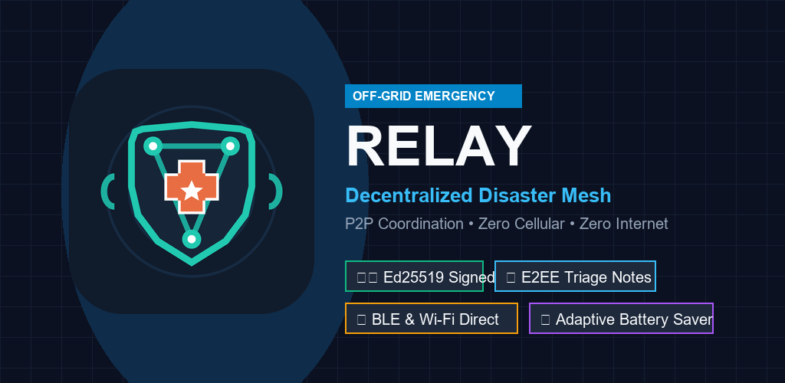

# Relay — Offline Emergency Mesh Network



[](https://www.android.com/)
[](https://kotlinlang.org/)
[](https://developer.android.com/jetpack/compose)
[](https://developers.google.com/nearby/connections/overview)
[](https://www.bouncycastle.org/)

**Relay** is a decentralized, off-grid emergency communication and rescue coordination system for Android. Designed for natural disasters, blackouts, and search-and-rescue operations where cellular towers, power grids, and internet backbones have failed.

Relay transforms everyday Android smartphones into autonomous radio relay nodes that automatically discover each other over **Bluetooth Low Energy (BLE)** and **Wi-Fi Direct**, routing critical rescue beacons, medical triage reports, and supply requests across physical distances via store-and-forward mesh networking.

---

## 🌟 Key Capabilities

### 1. Zero-Internet Store-and-Forward Mesh
- **Fully Autonomous P2P Networking**: Operates with zero cell service, zero Wi-Fi routers, and zero centralized cloud servers.
- **Multi-Hop Relay Protocol**: Packets automatically hop across intermediary peer devices (up to 5 hops) until reaching designated emergency responders or field hospitals.
- **Epidemic Store-and-Forward**: Packets are saved locally and forwarded whenever a new peer radio comes within range (~100m direct range per hop).
- **Cryptographic Delivery ACKs**: Reliable delivery confirmation signatures propagated back to the originator.

### 2. Military-Grade Cryptography & Anti-Tamper Security
- **Ed25519 Digital Signatures**: Every emergency request and status update is signed using hardware-backed cryptographic keys (Android Keystore / StrongBox / TEE).
- **X25519 End-to-End Encryption (E2EE)**: Sensitive medical triage notes and victim identities are encrypted end-to-end; intermediary relay hops can route the packet but cannot read private details.
- **Authorized Responder Verification**: Status transitions (Pending ➔ In Progress ➔ Resolved) require verifiable cryptographic authorization credentials from registered coordinators.
- **Anti-Replay & Loop Prevention**: Vector clock sequence numbering, node history tracking, and replay cache gates reject manipulated or replayed packets.

### 3. Offline Tactical GPS Navigation
- **Offline Haversine Engine**: Computes exact geodesic distance between responder and victim offline.
- **Azimuth Compass Bearing (0°–360°)**: Real-time heading calculations with 8-wind directional arrow vectors (`N ↑`, `NE ↗`, `E →`, etc.).
- **Satellite Fix Telemetry**: Integrates GPS latitude, longitude, altitude, accuracy radius, and direct map coordinate integration.

### 4. Modern, Tactical Hardware-Accelerated UI
- **Animated Radar Intro**: Silky-smooth 60fps radar sweep scanner, breathing shield badge, and glowing multi-tone gradient typography.
- **Tactical Command Center**: Live network status, store-and-forward metrics dashboard (Received, Forwarded, ACKs Done), and instant event logging with one-tap Clear action.
- **Day / Night Dynamic Themes**: Full Material 3 dark tactical and light accessibility themes.

---

## 🛠️ Architecture & Tech Stack

| Component | Technology |
|---|---|
| **Language** | Kotlin 2.2 |
| **UI Framework** | Jetpack Compose (Material 3) |
| **Mesh Networking** | Google Nearby Connections API (P2P Cluster / Star Strategy) |
| **Background Engine** | Android Foreground Service (`connectedDevice` type) |
| **Cryptographic Primitives** | Ed25519, X25519, BouncyCastle, Android Keystore StrongBox/TEE |
| **Tactical Geodesics** | Haversine Formula, Azimuth Forward Bearing, 8-Wind Directional Vectors |
| **Storage & Persistence** | Atomic SharedPreferences Commit Engine with Retention Pruning |
| **Testing** | JUnit 4 (46/46 unit tests passing across crypto, mesh, and GPS) |

---

## 📱 Permissions Used

Relay operates with transparent, minimal permissions strictly required for off-grid hardware radios:

- `ACCESS_FINE_LOCATION` & `ACCESS_COARSE_LOCATION`: Required by Android OS for Bluetooth LE hardware beacon discovery and offline tactical distance calculations.
- `BLUETOOTH_SCAN`, `BLUETOOTH_CONNECT`, `BLUETOOTH_ADVERTISE`: Offline peer radio discovery and multi-device connection negotiation.
- `NEARBY_WIFI_DEVICES`: High-bandwidth offline packet exchange via Wi-Fi Direct.
- `FOREGROUND_SERVICE` & `FOREGROUND_SERVICE_CONNECTED_DEVICE`: Uninterrupted mesh packet relaying in the background while device screen is locked.

---

## 🚀 Getting Started

### Prerequisites
- Android Studio Ladybug / Meerkat (or newer)
- Android SDK 35 (compileSdk 35, minSdk 26)
- JDK 17+ (e.g. Android Studio JBR)

### Clone & Build
```bash
# Clone the repository
git clone https://github.com/<your-username>/Relay.git
cd Relay

# Run unit tests (46 tests)
./gradlew testDebugUnitTest

# Assemble Debug APK
./gradlew assembleDebug

# Build Google Play Production Bundle (.aab)
./gradlew bundleRelease
```

### Install onto Device via ADB
```bash
adb install -r app/build/outputs/apk/debug/app-debug.apk
```

---

## 📄 Privacy Policy

Relay is built on a **Zero-Cloud, Zero-Tracking** architecture. No analytics, tracking pixels, ads, or external telemetry are embedded. Read our complete [Privacy Policy](docs/privacy-policy.html).

---

## 📜 License

This project is licensed under the MIT License — see the LICENSE file for details.
